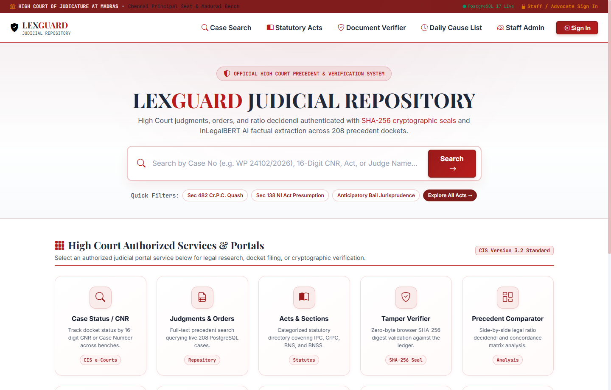
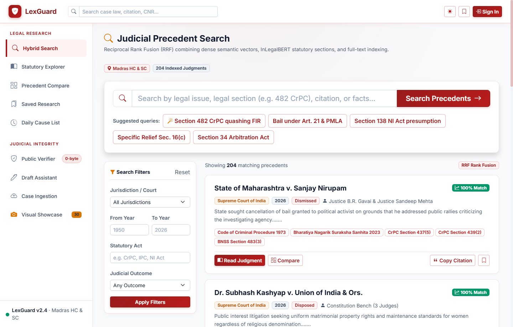
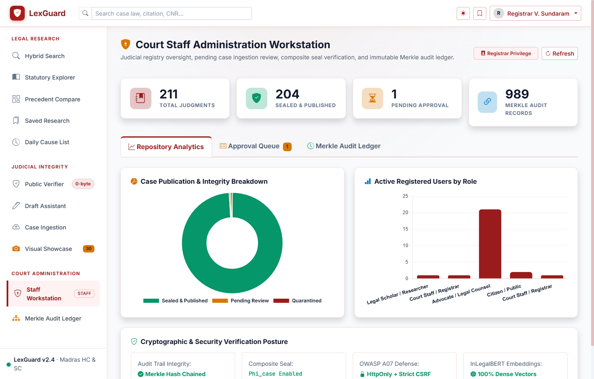
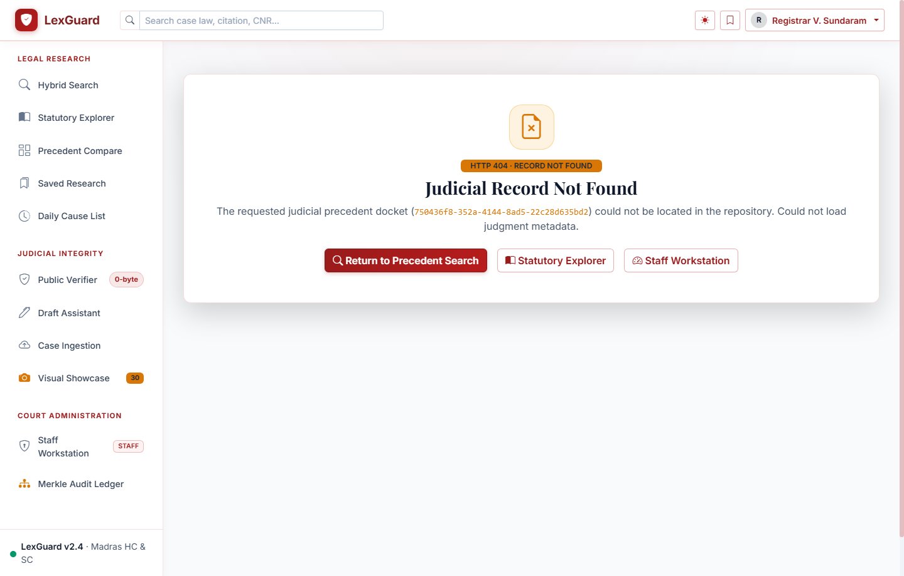

# 🏛️ LexGuard — High Court Judicial Case Repository & Verification Platform

[](https://www.python.org/)
[](https://fastapi.tiangolo.com/)
[](https://www.postgresql.org/)
[](https://getbootstrap.com/)
[](https://github.com/Vijayaraj-IHT/LexGuard-HTML)
[](https://developer.mozilla.org/en-US/docs/Web/API/Web_Crypto_API)
[](LICENSE)

> **High Court of Judicature at Madras · Chennai Principal Seat & Madurai Bench**  
> An enterprise-grade, zero-build judicial case repository and cryptographic document verification system designed for Court Staff, Judicial Registrars, Advocates, and Legal Researchers.

---

## 📸 Visual Execution Showcase

| High Court Portal Landing (10-Service Grid) | Precedent Hybrid Search (278-record canonical dump) |
| :---: | :---: |
|  |  |

| Staff CIS Workstation & Chart.js Analytics | Advanced PDF.js Viewer & Dossier |
| :---: | :---: |
|  |  |

*(Explore all 31 full-resolution output states inside the interactive [`frontend/screenshots-gallery.html`](frontend/screenshots-gallery.html))*

---

## ⚖️ Key Architectural Highlights

* **Pure HTML5 / Bootstrap 5 / jQuery Client (Zero-Build Frontend)**:
  * No `npm`, `node_modules`, `webpack`, or `vite` required.
  * Instant execution directly from any web browser or lightweight HTTP server.
  * Native Web Crypto API integration for client-side zero-byte SHA-256 calculation.
* **High Court Red & White Design System**:
  * Authentic judicial palette: Deep Crimson (`#991b1b`), Maroon (`#7f1d1d`), and Pristine White (`#ffffff` / `#f8fafc`).
  * Dark charcoal slate typography (`#0f172a`) providing high contrast and compliance with court readability standards.
  * Replaced dark background cards with clean elevated judicial panels and subtle crimson borders (`rgba(185, 28, 28, 0.15)`).
* **Robust FastAPI & PostgreSQL 17 Backend**:
  * 278 precedent judgments in the canonical `database/database_dump.sql`, indexed with statutory embeddings and full-text vectors.
  * SHA-256 hash-chained, tamper-evident audit ledger. The canonical dump contains 1,393 legacy audit records; that legacy segment is known invalid (first broken link at replay index 31) and must be migrated to segment 0, preserved unchanged, and explicitly resealed by senior staff before the active segment can be reported valid.
  * OWASP A02/A07 defense: SecurityHeadersMiddleware, Double-Submit Cookie CSRF protection, and HttpOnly JWT cookies.

---

## 🏛️ 10 High Court Authorized Services & Portals

1. **Case Status / CNR Lookup** (`search.html`): Search by 16-digit CNR, Filing Number, FIR, or Judge Name.
2. **Precedent Hybrid Search** (`search.html`): Reciprocal Rank Fusion (RRF) combining dense semantic vectors and statutory full-text search.
3. **Statutory Acts & Concordance** (`acts-explorer.html`): Directory covering IPC, Cr.P.C., Evidence Act, and automatic concordance mapping to Bharatiya Nyaya Sanhita (BNS) 2023.
4. **SHA-256 Tamper Verification Engine** (`verify.html`): Drag-and-drop client-side file digest computation validated against the PostgreSQL audit ledger.
5. **Multi-Precedent Comparator** (`case-compare.html`): Side-by-side legal ratio decidendi divergence and Cr.P.C. 1973 ↔ BNSS 2023 concordance matrix.
6. **Staff CIS Review Workstation** (`case-review.html`): Split-screen human-in-the-loop review with PDF on the left and editable CIS docket fields on the right.
7. **AI Judgment Draft Studio** (`draft-assistant.html`): Structured judicial drafting environment with session persistence and statutory audit stepper.
8. **Madras HC Illustrative Cause Board** (`cause-list.html`): Demonstration board arranging published repository cases by hall, stage and status. This is not an official daily cause list or live proceedings feed.
9. **Cryptographic Hash-Chained Audit Ledger** (`audit-ledger.html`): Segment-aware SHA-256 hash-chain inspector. It reports the active segment separately from archived/superseded segments.
10. **Case Ingestion Desk** (`case-upload.html`): PDF ingest pipeline with InLegalBERT entity extraction and automated SHA-256 sealing.

---

## ⚡ 1-Minute Quick Start

### Prerequisites
* **Python 3.11 or 3.12** (the Phase-0 test suite runs on 3.11; see `.python-version`)
* **PostgreSQL 17** (or 14+) with database `lexguard` created

### 🚀 Windows (1-Click Launcher)
Simply double-click:
```cmd
start_windows.bat
```
*This script will create the virtualenv, install dependencies, start the backend on port 8000, start the HTML frontend on port 8888, and automatically open your default browser!*

### 🐧 Linux / macOS
```bash
chmod +x start_linux.sh
./start_linux.sh
```

---

## 🛠️ Manual Step-by-Step Setup

### 1. Clone the Repository
```bash
git clone https://github.com/Vijayaraj-IHT/LexGuard-HTML.git
cd LexGuard-HTML
```

### 2. Backend Setup
```bash
cd backend
python -m venv venv

# Windows
venv\Scripts\activate
# Linux/macOS
source venv/bin/activate

pip install -r requirements.txt
cp .env.example .env
```

### 3. Database Restoration (278 Cases & 1,393 Legacy Audit Logs)
Ensure PostgreSQL is running, then restore the included database dump:
```bash
# Windows / Linux / macOS
psql -U lexguard -d lexguard -f ../database/database_dump.sql
```
*(Default credentials in `.env.example`: User: `lexguard`, Password: `lexguard123`, DB: `lexguard`)*

#### Required Phase-0 ledger remediation after restoration

The restored legacy audit chain in `database_dump.sql` is **not valid as shipped**: replay fails at index 31 and the segment contains forks created by historical non-canonical writers. Do not edit or recompute those historical rows. Instead:

```bash
cd backend
python migrate_phase0.py
python ../scripts/reseal_audit_chain.py \
  --email staff@lexguard.gov.in \
  --reason "Phase-0 disclosed remediation of legacy audit segment" \
  --confirm
```

The migration adds `seq`/`segment`, labels restored rows as legacy segment 0, converts audit user/case foreign keys to `ON DELETE RESTRICT`, and moves any orphan approval seal from `redacted_file_hash` to `judicial_seal`. The reseal appends one `CHAIN_RESEALED` genesis event in a new segment through `audit_service`; verification continues to disclose the archived invalid segment separately.

### 4. Launch Services
**Terminal 1 (FastAPI Backend on port 8000):**
```bash
cd backend
python -m uvicorn app.main:app --host 127.0.0.1 --port 8000 --reload
```

**Terminal 2 (HTML5 Frontend on port 8888):**
```bash
cd frontend
python -m http.server 8888
```

Open your browser to: **`http://127.0.0.1:8888/index.html`**

---

## 🔑 Demo Access Personas

The database comes pre-seeded with authorized credentials for all four judicial roles:

| Role | Email | Password | Access Privileges |
| :--- | :--- | :--- | :--- |
| **Court Registrar (Staff)** | `staff@court.gov.in` | `staff123` | CIS moderation, hash-chained audit ledger, ingestion desk, analytics |
| **Chief Registrar (Senior Staff)** | `staff@lexguard.gov.in` | `Admin@Lexguard2026` | Senior case decisions (non-self), user administration, audit-chain reseal |
| **Senior Advocate** | `advocate@bar.in` | `advocate123` | Case Search, Citation Bookmarks, Judgment Export, Precedent Compare |
| **Legal Scholar** | `scholar@law.edu` | `scholar123` | Statutory Concordance, Landmark Summaries, Ratio Decidendi Analysis |
| **Citizen / Litigant** | `public@citizen.in` | `public123` | Public Case Status Lookup, Illustrative Cause Board, SHA-256 Verifier |

---

## 📂 Repository Structure

```
LexGuard-HTML/
├── frontend/                     # Pure HTML5 / Bootstrap 5 / jQuery Client
│   ├── index.html                # Madras High Court Portal & 10-Service Grid
│   ├── search.html               # Hybrid Precedent Search & Query Pills
│   ├── admin.html                # Staff Workstation & Chart.js Visualizations
│   ├── case-viewer.html          # PDF.js Reader, Text Layer, Keyword Stepper
│   ├── case-review.html          # Split-Screen CIS Human-in-the-Loop Review
│   ├── case-compare.html         # 3-Precedent Tray & BNSS Concordance
│   ├── draft-assistant.html      # AI Judgment Draft Assistant Studio
│   ├── acts-explorer.html        # Indian Statutory Directory & Concordance
│   ├── verify.html               # Web Crypto SHA-256 Tamper Verification
│   ├── cause-list.html           # Illustrative Cause Board (not an official cause list)
│   ├── audit-ledger.html         # Cryptographic Hash-Chained Audit Ledger
│   ├── case-upload.html          # PDF Ingestion Desk
│   ├── bookmarks.html            # Saved Precedents
│   ├── 404.html                  # Judicial 404 Not Found Screen
│   ├── screenshots-gallery.html  # 31-Task Visual Execution Showcase
│   ├── css/                      # High Court Red & White CSS Engine
│   ├── js/                       # API Services, Nav Loader, Page Logic
│   ├── screenshots/              # 31 Visual Audit Execution Screenshots
│   └── favicon.svg               # High Court Crimson Shield
├── backend/                      # FastAPI Python Backend
│   ├── app/                      # Models, Endpoints, Services, Security
│   ├── storage/cases/            # Judgment PDF corpus for the 278-record canonical dump
│   ├── requirements.txt          # Minimal Python Dependencies
│   └── .env.example              # Environment Configuration
├── database/                     # Database Assets
│   ├── database_dump.sql         # Canonical PostgreSQL dump (278 cases, 1,393 legacy audit logs)
│   ├── lexguard_dump.sql         # Superseded older dump (145 cases); do not use for Phase-0 counts
│   └── seed_105_cases.py         # Python Seeder Script
├── scripts/                      # Utility Scripts
│   ├── capture_html_red_white.py # Headless Edge Visual Audit Script
│   └── find_404_errors.py        # Route Integrity Validator
├── start_windows.bat             # 1-Click Windows Launcher
├── start_linux.sh                # 1-Click Linux Launcher
├── index.html                    # Root Portal Redirect
├── LICENSE                       # MIT License
└── README.md                     # Documentation
```

---

## 🔒 Security & Cryptographic Integrity

* **Zero-Byte Client Hashing**: File digests are computed directly in the client browser using the W3C Web Cryptography API (`crypto.subtle.digest('SHA-256', buffer)`). Sensitive case documents are never sent over the network merely to compute checksums.
* **Hash-Chained Audit Ledger**: Application events are appended through the single `audit_service` writer. Each SHA-256 record links to the prior record in its segment and receives a monotonic `seq`, making later edits detectable during verification. This is tamper-evident, not tamper-proof: an attacker able to rewrite both rows and hashes could recompute a segment, and no external timestamp anchor is included in Phase 0.
* **OWASP Hardened Headers**: Every API response enforces `X-Content-Type-Options: nosniff`, `X-Frame-Options: DENY`, and strict Content Security Policies.

---

## 📜 License

Distributed under the **MIT License**. See [`LICENSE`](LICENSE) for full details.  
Maintained by **Vijayaraj** ([@Vijayaraj-IHT](https://github.com/Vijayaraj-IHT)).
